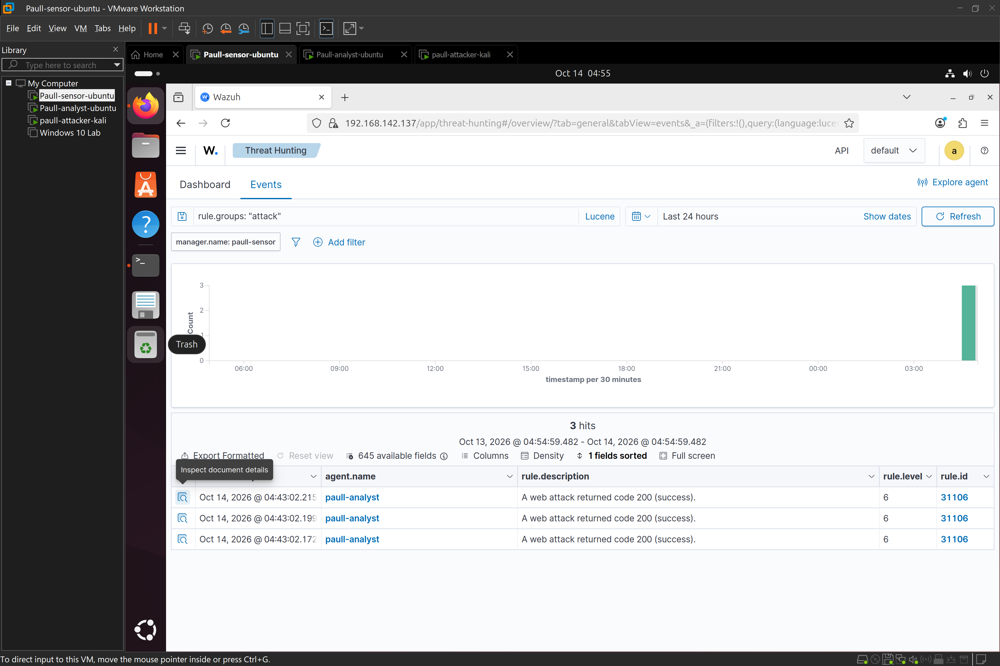
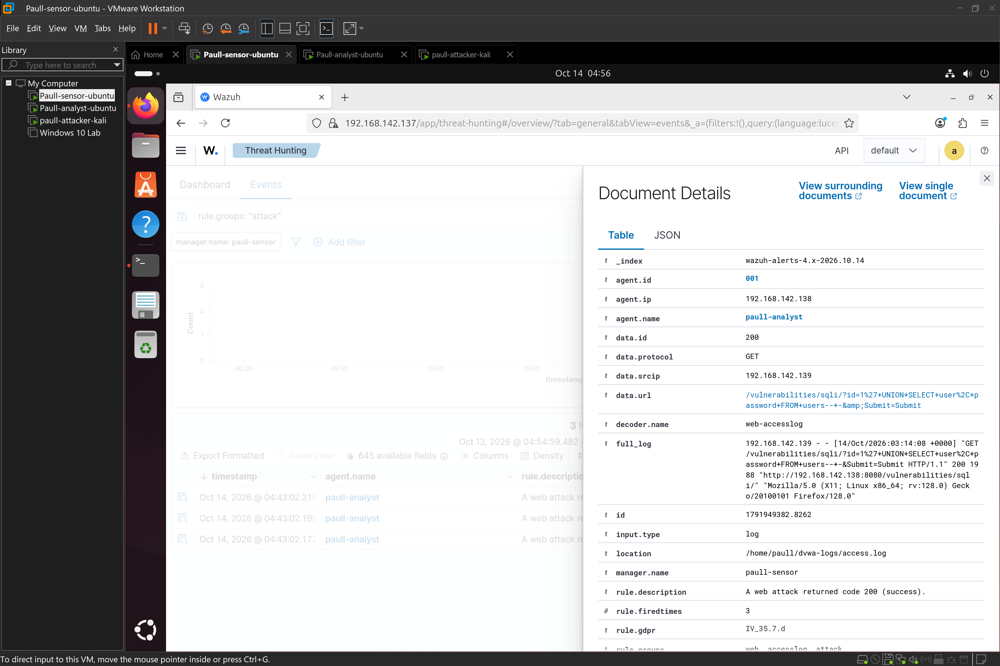
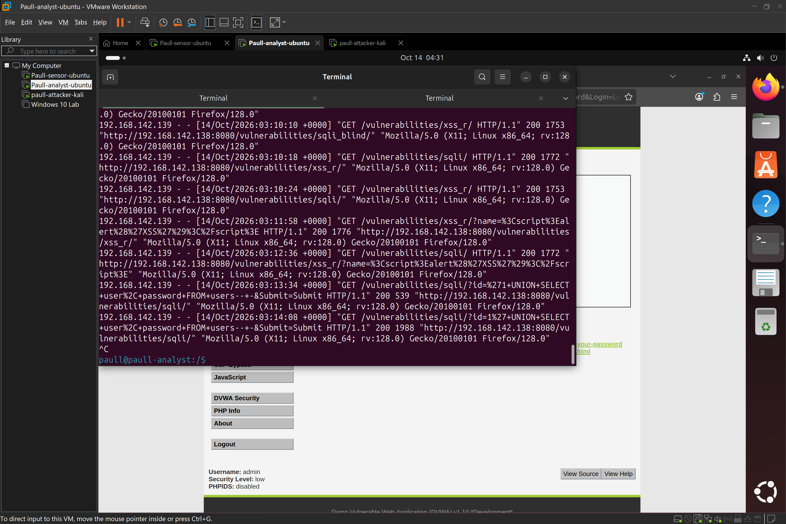

# Web-App-Attack-Detection-OWASP-Top-10-SQLi-XSS-vs-DVWA (WAZUH)
 

## Objective
Detect SQL Injection and Reflected XSS attacks against a deliberately vulnerable web app (DVWA) using Apache access logs forwarded into Wazuh, and evaluate how much of the attack surface the default Wazuh ruleset actually catches out of the box — rather than assume it does.

## Environment
| Role | Hostname | Tool Stack |
|---|---|---|
| Attacker | paull-attacker-kali | Kali Linux, Firefox, Burp Suite |
| Victim | paull-analyst | Ubuntu Server, Docker, DVWA (vulnerables/web-dvwa), Wazuh Agent |
| SIEM | paull-sensor | Ubuntu Server, Wazuh Manager + Indexer + Dashboard |

## Setup

### 1. DVWA deployed via Docker in my  paull-analyst environment 

paull-analyst already had a native Apache+DVWA install from an earlier lab series, which was occupying port 80. Rather than tear that down, I deployed DVWA  via Docker on an alternate port:

```bash
sudo apt install docker.io -y
sudo systemctl enable --now docker
mkdir -p ~/dvwa-logs

sudo docker run -d \
  --name dvwa \
  -p 8080:80 \
  -v ~/dvwa-logs:/var/log/apache2 \
  vulnerables/web-dvwa
```

**Key setup decision:** the container's `/var/log/apache2` was bind-mounted out to `~/dvwa-logs` on the host. Without this, Apache's access/error logs exist only inside the container's filesystem and are invisible to a host-based Wazuh agent — `docker logs` shows stdout/stderr, not the actual Apache log files. The mount makes the logs physically present on the host at `/home/paull/dvwa-logs/access.log`, which is what the agent can actually tail.

DVWA was then initialized at `http://paull-analyst-ip:8080/setup.php` (Create/Reset Database), logged into with the default `admin` / `password`, and set to **Security Level: Low** for this first pass.

### 2. Log forwarding into Wazuh

Added to `/var/ossec/etc/ossec.conf` on paull-analyst:

```xml
<localfile>
  <log_format>apache</log_format>
  <location>/home/paull/dvwa-logs/access.log</location>
</localfile>
```

```bash
sudo systemctl restart wazuh-agent
```

File permissions on the mounted log (`-rw-r--r-- root:root`, i.e. 644) were already world-readable, so no chmod/ownership changes were needed for the agent to read it — confirmed by tailing the file live while hitting DVWA pages in a browser and watching new lines append in real time.

## Attack Simulation

Four payloads were submitted from Kali against DVWA (low security):

| # | Type | Payload | Target |
|---|---|---|---|
| 1 | SQLi (UNION-based) | `1' UNION SELECT user, password FROM users-- -` | SQL Injection module |
| 2 | SQLi (boolean tautology) | `1' OR '1'='1` | SQL Injection module |
| 3 | XSS (script tag) | `<script>alert('XSS')</script>` | XSS (Reflected) module |
| 4 | XSS (event handler) | `` | Not submitted — descoped |

Each confirmed via the UI: the UNION payload dumped the full user table instead of a single row; the `OR '1'='1'` payload likewise returned all rows; the `<script>` payload triggered a JS alert box on submission.

## Log Review

All submitted payloads were confirmed landing in `/home/paull/dvwa-logs/access.log` via `grep`, e.g.:

```
192.168.142.139 - - [14/Oct/2026:03:14:08 +0000] "GET /vulnerabilities/sqli/?id=1%27+UNION+SELECT+user%2C+password+FROM+users--+-&Submit=Submit HTTP/1.1" 200 1988 ...
192.168.142.139 - - [14/Oct/2026:03:09:07 +0000] "GET /vulnerabilities/sqli/?id=1%27+OR+%271%27%3D%271&Submit=Submit HTTP/1.1" 200 1854 ...
192.168.142.139 - - [14/Oct/2026:03:11:58 +0000] "GET /vulnerabilities/xss_r/?name=%3Cscript%3Ealert%28%27XSS%27%29%3C%2Fscript%3E HTTP/1.1" 200 1776 ...
```

All three returned HTTP 200 — the requests reached the application successfully, which matters for what came next.

## SIEM Detection — Default Ruleset

Checked Wazuh Security Events, filtered to the `paull-analyst` agent, across the attack window.

| Payload | Logged? | Default rule fired? |
|---|---|---|
| UNION SELECT SQLi | Yes | **Yes** — rule 31106 |
| `OR '1'='1'` SQLi | Yes | **No** |
| `<script>` XSS | Yes | **No** |
| `` XSS | Not tested | — |

**Detail on the one hit:**

```
rule.id: 31106
rule.description: A web attack returned code 200 (success).
rule.level: 6
rule.groups: web, accesslog, attack
rule.mitre.id: T1190
rule.mitre.tactic: Initial Access
rule.mitre.technique: Exploit Public-Facing Application
data.url: /vulnerabilities/sqli/?id=1%27+UNION+SELECT+user%2C+password+FROM+users--+-&Submit=Submit
data.srcip: 192.168.142.139
decoder.name: web-accesslog
```

**Finding:** Wazuh's default web-attack signature (rule 31106) caught the UNION-based SQLi but missed both the simpler boolean-tautology SQLi (`OR '1'='1'`) and the reflected XSS payload entirely, despite all three being logged identically and all three returning HTTP 200. This indicates the default rule's pattern-matching leans on recognizable SQL keyword sequences (`UNION`, `SELECT`) rather than generic injection syntax, and does not appear to include XSS-specific indicators (`<script`, `onerror=`, etc.) at all in this ruleset version. This mirrors the earlier auditd lab's conclusion from a different angle: default detection coverage cannot be assumed complete, even for a well-known OWASP Top 10 category, and has to be validated payload-by-payload rather than taken on faith from one successful hit.

## Step 6 — Custom Rule (Attempted Remediation)

Two custom rules were written to `/var/ossec/etc/rules/local_rules.xml` on paull-sensor to specifically cover the two gaps identified:

```xml
<group name="local,web,attack,">

  <rule id="100100" level="8">
    <if_sid>31100</if_sid>
    <url type="pcre2">(?i)(\bOR\b|\bAND\b)\s*['"]?\s*\d+\s*['"]?\s*=\s*['"]?\s*\d+</url>
    <description>SQL Injection: boolean-based tautology pattern in URL (e.g. OR '1'='1') - not caught by default rule 31106</description>
    <mitre>
      <id>T1190</id>
    </mitre>
    <group>sql_injection,web_attack,</group>
  </rule>

  <rule id="100101" level="8">
    <if_sid>31100</if_sid>
    <url type="pcre2">(?i)(&lt;script|onerror\s*=|onload\s*=|javascript:)</url>
    <description>XSS: script tag or event-handler payload detected in URL - not caught by default rule 31106</description>
    <mitre>
      <id>T1059.007</id>
    </mitre>
    <group>xss,web_attack,</group>
  </rule>

</group>
```

Rule file validated and loaded cleanly (`wazuh-control restart` completed with no XML errors — two iterations were needed first, documented below as a troubleshooting note). Payloads 2 and 3 were then resubmitted from Kali to validate the new rules.

**Result: neither custom rule fired.** Only the original rule 31106 event from the earlier UNION SELECT test appeared in Security Events — the retested `OR '1'='1'` and `<script>` payloads produced no alert under rule 100100, 100101, or anything else.

**Assessment:** in my opinion this is a legitimate secondary finding, not a dead end, though it seemed like one at some point. The custom rule failed to activate despite loading without syntax errors, meaning the rule logic itself — not just the XML — needs debugging. Leading hypotheses for a follow-up session:
- `<if_sid>31100</if_sid>` may not be the correct parent rule ID to inherit from for this decoder chain (31100 wasn't independently confirmed to exist/match against `web-accesslog`-decoded events before being used as a parent).
- The `<url>` field tag may not correspond to the actual field name the `web-accesslog` decoder populates for pcre2 matching — needs confirmation via `sudo /var/ossec/bin/wazuh-logtest` against a real log line rather than assumed from the rule-writing convention.
- Possible need for `decoded_as` or `data.url` style field reference instead of a bare `<url>` tag depending on ruleset version.

This gap — writing a rule that loads cleanly but silently never matches — is itself a realistic and common SOC/detection-engineering experience worth having in the portfolio: a rule passing XML validation is not the same as a rule being functionally correct, and verifying a custom rule actually fires against live data is a mandatory step, not a formality.

## Troubleshooting Notes 

1. **XML special characters in rule patterns:** the first draft of rule 100101 used a literal `<script` inside the `<url>` regex, which the XML parser interpreted as an unclosed tag rather than literal text. Fixed by escaping as `&lt;script`. Any literal `<` or `>` inside a Wazuh rule pattern needs XML entity escaping.
2. **Nested `<group>` blocks are invalid:** when adding the new rule group, it was initially pasted inside the existing example `<group name="local,syslog,sshd,">` block rather than after its closing tag, producing an "Element 'group' is not a valid element" error. Wazuh rule groups must be sibling top-level elements, never nested.
3. **Terminal paste corruption:** a multi-line heredoc paste into an SSH terminal session produced duplicated and garbled content (arrow-key escape sequences leaking into the buffer) rather than clean insertion. Recovered by clearing the file and re-pasting the content directly inside `nano` rather than via a shell heredoc — more reliable for multi-line XML paste over this particular terminal setup.

## Incident Report — Web Application Attack

```
Date/Time: October 14, 2026, approx. 03:09-03:14 UTC
Target App: DVWA (Docker, vulnerables/web-dvwa), paull-analyst:8080
Attack Types: SQL Injection (UNION-based, boolean-tautology), Reflected XSS
Source IP: 192.168.142.139 (Kali attacker host)
Target IP: 192.168.142.138 (paull-analyst)

Payloads Observed:
  1. 1' UNION SELECT user, password FROM users-- -   [SQLi]
  2. 1' OR '1'='1                                     [SQLi]
  3. <script>alert('XSS')</script>                    [XSS]
  4.  — not tested     [XSS]

SIEM Detection:
  Payload 1: YES — rule 31106 "A web attack returned code 200 (success)", 
             level 6, MITRE T1190
  Payload 2: NO  — logged but no alert under default ruleset
  Payload 3: NO  — logged but no alert under default ruleset
  Custom rules (100100 SQLi tautology, 100101 XSS) written and loaded 
             successfully but did NOT fire on retest — functional gap 
             requires wazuh-logtest debugging in a follow-up session

Recommendation:
  - Input validation and parameterized queries at the application layer 
    (DVWA's "low" security setting is intentionally unsafe — real apps 
    must never concatenate user input into SQL strings)
  - Output encoding/escaping to prevent reflected XSS regardless of input filtering
  - WAF deployment (e.g. ModSecurity with OWASP CRS) as a compensating control, 
    since this exercise shows the SIEM's detective control alone has real gaps
  - Do not assume a SIEM's default ruleset provides complete OWASP Top 10 
    coverage — validate each attack class/payload variant individually, 
    the same way this lab did
  - Follow-up: debug why custom rules 100100/100101 loaded without error 
    but did not match live events; confirm correct parent rule ID and field 
    name via wazuh-logtest before considering the gap closed
```

# Screenshots





## Tools Used
- Docker, DVWA (vulnerables/web-dvwa)
- Kali Linux, Firefox
- Ubuntu Server, Apache (inside container)
- Wazuh (Manager, Indexer, Dashboard, Agent)

